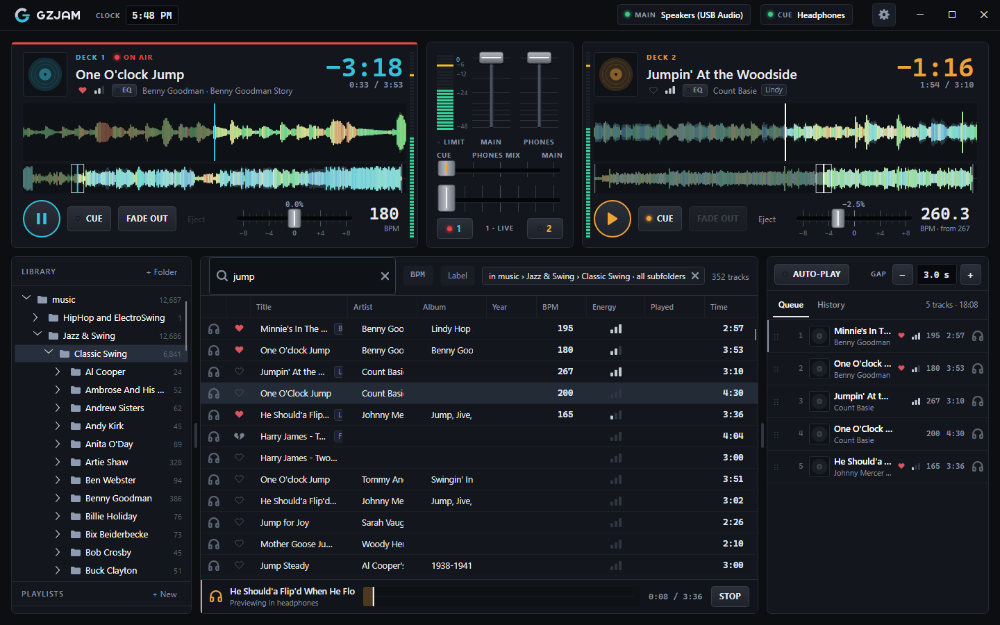
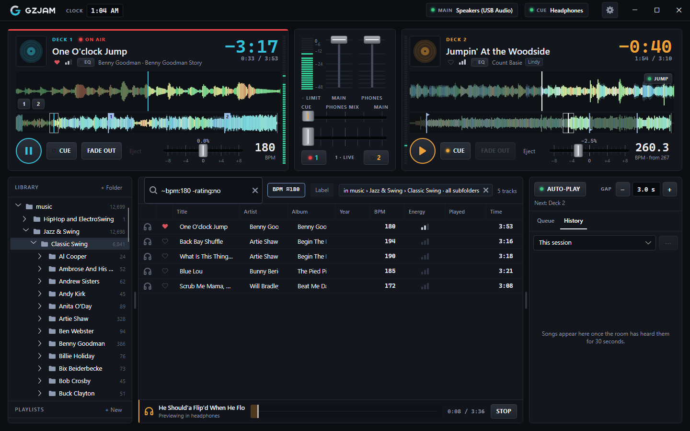
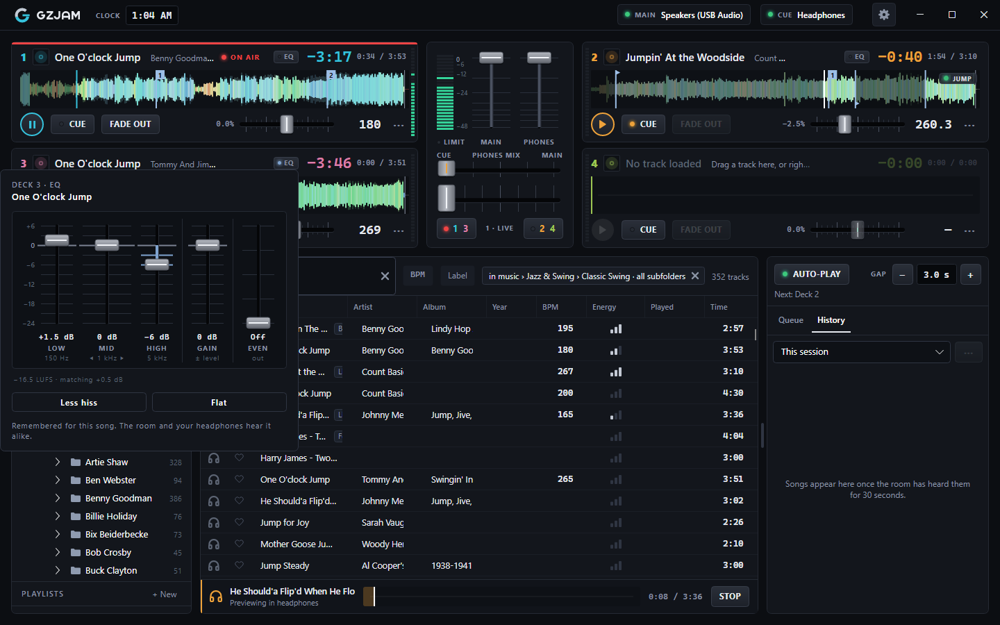
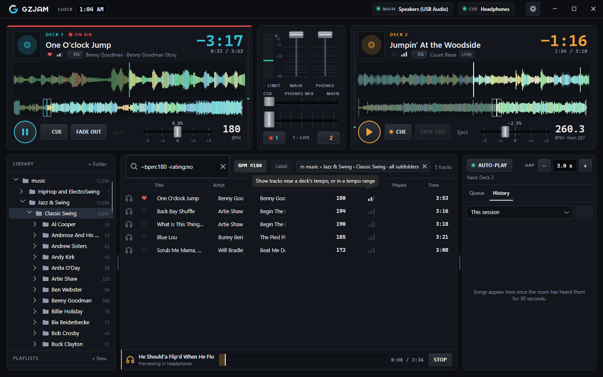

# GZJam user guide

GZJam is a free DJ app for social dance nights: swing, West Coast, blues, ballroom and more. You
play whole songs, choose them for the floor, and keep the music going without surprises. This
guide covers everything GZJam does, from your first song to what to do if the sound stops.

**Contents**

1. [Getting started](#getting-started)
2. [The screen](#the-screen)
3. [Outputs: speakers, headphones and booth](#outputs-speakers-headphones-and-booth)
4. [Decks](#decks)
5. [The mixer](#the-mixer)
6. [The library](#the-library)
7. [The queue and auto-play](#the-queue-and-auto-play)
8. [History and set lists](#history-and-set-lists)
9. [Settings](#settings)
10. [At a gig](#at-a-gig)
11. [Problems](#problems)
12. [Keys and gestures](#keys-and-gestures)

---

## Getting started

1. **Install GZJam.** [Download the latest release](https://github.com/GemZombie/GZJam/releases/latest)
   and pick the file for your computer (see the [README](../README.md#download)). The first time
   you open it, Windows or macOS may ask you to confirm, since GZJam isn't signed with a paid
   certificate.
2. **Add your music.** Click **+ Folder** above the folder tree and pick your music folder. GZJam
   lists its songs in a few seconds (13,000 songs take about 3), then keeps watching it: songs you
   add, rename or delete later show up by themselves. You can add more than one folder.
   **GZJam never changes your music files.** Hearts, labels, cues and everything else you give your
   songs live in GZJam's own library.
3. **Choose your outputs.** Click **MAIN** in the top bar (or the gear, then *Sound*). Pick the
   **Speakers** (what the room hears) and the **Headphones** (only you hear them). Choose them by
   name rather than *Default*. Only one output? See [one output for both](#one-output-for-both-a-splitter-cable).
4. **Load a song.** Drag it from the list onto Deck 1, or right-click it › *Load to Deck 1*.
5. **Play it to the room.** The crossfader decides which side the room hears. Tap **1** under the
   crossfader, then press play on Deck 1: the deck says **ON AIR**.
6. **Cue the next song.** Load a song onto Deck 2 and press its **CUE** key: you hear it in the
   headphones while the room hears Deck 1. Or tap the 🎧 icon on any row in the list to preview it
   without loading it at all.
7. **Change over.** When Deck 1's song ends, press play on Deck 2 and tap **2** under the
   crossfader (it glides over in a moment). Or let [auto-play](#the-queue-and-auto-play) do it.

While GZJam works through your library the first time, the top bar says *First-time analysis…*:
it's listening to each song once, start to finish, to find where it really starts and ends, its BPM,
its loudness and its waveform. On a big library this takes a while (an hour or two for 12,000 songs,
depending on the laptop); once enough songs are done, the top bar says roughly how long is left, and
pointing at it says how many are done. It's done once: after that, only songs new to your music
folders are analyzed. You can play right away; a song you load or queue is analyzed first.

Now and then a new version of GZJam analyzes songs better, and listens to each one again, once: the
top bar then says *Updating analysis…*.

---

## The screen

- **Top bar:** the clock, what's happening in the background (scanning, analyzing), short notices,
  and your outputs: **MAIN** (the speakers), **CUE** (the headphones) and **BOOTH** once you've
  chosen one. A green light means it's playing; red or amber means it isn't connected. Click any of
  them to open Settings › Sound. The gear opens Settings.
- **Decks** along the top, with the **mixer** between them.
- **The library** below: the folder tree and playlists on the left, the song list in the middle.
- **The queue and History** on the right, with **AUTO-PLAY** and the **GAP** above them.

The dividers between the panels can be dragged to give one more room.

---

## Outputs: speakers, headphones and booth

GZJam is the mixer: it sends the room's music to one output and your headphones to another.

- **Speakers:** what the room hears.
- **Headphones:** what you're cueing and previewing. **Never the room's output**: GZJam never sends
  the headphones to the speakers, even if something is unplugged.
- **Booth:** an optional monitor speaker at the DJ table, for big rooms where the speakers face
  away from you. It plays what the room hears (never your previews), at its own volume (*Booth
  volume*, under it in Settings).

A USB sound card for the speakers and the laptop's own jack for the headphones is the usual setup.

### One output for both (a splitter cable)

A laptop with one headphone jack and no sound card can still cue: turn on **One output for both
(splitter cable)** in Settings › Sound, and plug a DJ splitter cable into the jack (one stereo
plug to two mono sockets). The room plays from the left plug, your headphones from the right, both
in mono. Hearing it the wrong way round? Swap the two plugs. The top bar shows *Left ·* and
*Right ·* before the output's name.

### Speakers for GZJam alone (Windows)

On by default. While GZJam is open, other programs' sounds (a notification, a browser) can't reach
the room. It works for speakers chosen by name, not *Default*. If the speakers are also Windows'
default output, other programs may refuse to play while GZJam is open: Settings says so, and how
to avoid it (choose another output as Windows' default).

### When something is unplugged

- **The speakers' sound card:** GZJam says so and plays through the computer's default output
  instead, never the headphones' own. Plug it back in, then choose it again in Settings › Sound
  (*Plugged something in? Refresh the list*).
- **The headphones:** they go quiet, and nothing moves anywhere else. The top bar's CUE says
  *Unplugged* with an amber light. Plug them back in and within a few seconds they're back, with a
  notice, without a trip to Settings. The booth does the same.
- **Headphones on *Default*:** Settings warns you, because *Default* follows the computer's own
  choice, and when the headphones are unplugged the computer may move your preview to another
  output, even the room's. Choose the headphones by name.
- **A laptop whose headphone jack and built-in speakers are one output** (common with Realtek
  sound): the sound chip itself switches to the built-in speakers when you unplug, and GZJam can't
  tell. Test it before a night: preview a song and pull the plug.

---

## Decks

Two decks to start with; four if you turn on **Four decks** in Settings › Decks (Deck 3 under
Deck 1, Deck 4 under Deck 2, each half height).

**Compact decks:** on a laptop, the decks can be made smaller so the library and queue show more
songs. Press the arrows beside the gear in the top bar, press **Ctrl+D** (Cmd+D on a Mac), or drag
the small grip under the mixer up (and down again for big decks; a tap on it switches too). Switch
back and forth as often as you like during a night: nothing playing is affected. Compact decks keep
the title, time, waveform, play, CUE, FADE OUT and tempo, with the rest in each deck's ⋯ menu; the
mixer keeps the meter, MAIN, PHONES and the crossfader (PHONES MIX is hidden but still applies).
With four decks, compact decks also leave out the waveforms. GZJam remembers the choice.

### Loading and playing

- **Load:** drag a song onto a deck, or right-click it › *Load to Deck N*. Songs dragged in from
  Explorer, Finder or your Linux file manager load too, even from outside your music folders (a song
  a dancer brings on a USB stick).
- **A playing deck is protected:** by default GZJam won't load a song over one that's playing. The
  deck shows a "not allowed" outline as you drag over it, and the menu says *(playing)*. Change it in
  Settings › Decks › *Loading a playing deck*.
- **Play/pause:** the round key. **ON AIR** (red) means the room hears this deck; **OFF AIR** means
  it's playing but the crossfader is on the other side.
- **Eject** empties a deck that isn't playing.
- **One song per side:** with four decks, Decks 1 and 3 share the crossfader's left side and 2 and
  4 the right. GZJam won't start a deck the room would hear while the other deck on its side is on
  air ("Deck 1 is playing. Fade it out first").

### The readout

The big number is the time left, counting down to where the music ends (not the end of the file).
Tap it for time elapsed, then the BPM, then back. In the last 30 seconds of the song the room is
hearing it blinks slowly. When auto-play is about to start this deck, the status line says
*STARTS IN n*.

### The waveform

- **Two decks:** a close-up on top, the whole song underneath. The close-up scrolls past a fixed
  playhead; the box on the whole song shows what the close-up covers. Zoom with the mouse wheel or a
  pinch (2 to 30 seconds across).
- **Four decks:** the whole song; the mouse wheel or a pinch zooms that deck in.
- **Moving around:** off air, click or tap the whole song to go there, or drag the close-up like a
  record. **On air it's locked**, so a stray touch can't jump the music; tapping it says how to
  unlock it (move the crossfader off that deck). Cue keys and jumps still work on air.
- **The colors:** red is bass, green mids, blue highs. The shaded parts at either end are silence
  GZJam skips.

### Where a song starts and ends

GZJam finds where the music really starts and ends, so a 3-second gap is 3 seconds of real
silence every time. To set it yourself (after applause on a live recording, say), right-click (or
press and hold) the waveform › **Song starts** or **Song ends** › *Here*, *At the playhead* (find
the spot in the headphones first) or *Automatic*. A point you set gets a purple flag. You can also
drag the start and end markers.

### Cue keys

Mark up to four spots in a song to jump to at the moment you choose (wait for the end of a phrase,
then go to the outro): right-click the waveform › **Cue** › *Cue 1 here* or *at the playhead*. A
numbered key appears on the close-up; tap it to go there at once, on air or not. *Remove cue N* in
the same menu. With four decks, they're in the deck's ⋯ menu (*Go to cue N*). Cues can be dragged.

### Jumps

A jump leaves at the end of one phrase and lands at another, seamlessly: forward skips a part
(a long song's third chorus), backward plays one again (stretching a tune to fit a dance). Up to two
per song.

1. Right-click the waveform where it should leave › **Jump** › *Jump from here* (or *from the
   playhead*).
2. Right-click where it should land › *Land the jump here*.

The **JUMP** key over the waveform lights green when the song will jump. Each jump happens once;
tap JUMP to arm it again, or to cancel it for this play. The time left counts armed jumps.

### Tempo

The pitch fader changes the tempo up to ±8% without changing the key. Drag it (pressing beside the
cap never jumps the tempo), double-tap for 0, or use the mouse wheel or arrow keys for 0.1%. The BPM
under it is the song's BPM as the room hears it.

### BPM

GZJam detects every song's BPM (or uses the tag's). If it's wrong, right-click the BPM on a deck,
or songs in the list › **BPM**:

- **Detect in a range:** *Slow (60-110)*, *Medium (100-160)*, *Up-tempo (140-220)*, *Fast
  (200-320)*. GZJam listens again for the strongest tempo in that range, which fixes half- and
  double-time mistakes. Select a whole album to set them all at once.
- **Type the BPM…** if you know it.
- **Tap tempo…** (on a deck): tap along with the song on the TAP pad, then SET.
- **Automatic** goes back to what the tag or detection says.

### Hearts, energy and labels

The heart and energy bars beside the artist mark the song while it plays: tap to cycle. Labels
show as small chips. See [the library](#the-library) for what they're for.

### EQ, gain and evening out

The **EQ** chip opens a panel for fixing a recording, set once per song and remembered whenever it's
loaded: **low**, **mid** (◀ ▶ moves its frequency) and **high**, from -24 to +6 dB; **GAIN** on top of
loudness matching; and **EVEN**, which brings quiet passages up and loud ones down for an old,
uneven transfer. *Less hiss* turns the treble down 6 dB to start with; *Flat* resets it all. The chip
lights when a song has EQ. The room and the headphones hear it alike.

### Fade out

**FADE OUT** fades the deck out over 5 seconds (Settings › Decks › *Fade-out length*). It counts as
the song ending: auto-play waits the gap and starts the next one.

### Pausing or fading out a deck the room hears

So a stray touch or click can't stop the dance, the deck the room hears takes **two taps** to pause
or fade out: the first tap on the play key says *Tap again to pause*, and the first on FADE OUT
says *Tap again to fade out*; the key turns red for a few seconds, waiting for the second. Pressing
and holding the play key pauses too. A deck the room can't hear pauses and fades on one tap. To
pause and fade the live deck on one tap as well, choose **Tap** in Settings › Decks › *Pausing or
fading out the live deck*.

---

## The mixer

- **The meter** shows what the speakers play: one column in mono, two in stereo.
- **LIMIT** lights when the speakers are too loud and the limiter is holding them down. Turn a deck
  or the main volume down. Nothing GZJam plays can distort.
- **MAIN** and **PHONES** are the speakers' and headphones' volumes. From the keyboard: **Ctrl+↑/↓**
  (Cmd on Mac) turns MAIN up or down a little, and with **Shift**, PHONES.
- **PHONES MIX:** what the headphones hear. At **CUE** (the left), the decks you've cued and the
  preview; at **MAIN** (the right), what the room hears; in the middle, both.
- **The crossfader** fades the room between the decks: left is Deck 1 (and 3), right is Deck 2 (and
  4). Tap **1** or **2** to glide all the way over. It only decides what the room hears: the
  headphones are set per deck with **CUE**.
- **Each deck's own meter** (the slim column beside it) shows its level before the crossfader, so a
  deck the room can't hear shows its level too.

---

## The library

The song list shows your music; the folder tree shows it as it is on disk.

### Folders and search

- **Choosing a folder** narrows the list (and searches) to everything beneath it. Click it again to
  close it; the chip above the list shows the scope, and its ✕ goes back to the whole library.
- **Search** as you type, across titles, artists, albums, comments and folder names (`balboa` finds
  songs in a *Balboa* folder). Ctrl+F (Cmd+F on a Mac) jumps to the search box; Escape clears it.
- **Filters** you can type:

  | Type | For |
  |---|---|
  | `bpm:140`, `bpm:130-150`, `bpm:>200` | a BPM, or a range |
  | `~bpm:140` | songs that can be pitched to 140 (within 8%; `~bpm:140/5` for 5%) |
  | `artist:basie`, `title:`, `album:`, `genre:`, `comment:`, `folder:` | one field (`artist:"count basie"` for several words) |
  | `year:1938`, `year:1935-1940`, `year:<1950` | the year |
  | `rating:yes`, `rating:no`, `rating:none` | hearts |
  | `energy:high`, `energy:2-3` | energy |
  | `label:lindy`, `label:none` | labels |
  | `played:7`, `played:never`, `-played:7` | played in the last 7 days, never, or not this week |
  | `-live` | leave out a word or a filter |

- **The BPM button** beside the search box fills in a BPM filter by tap: *Near Deck 1* (the deck's
  tempo as the room hears it), a tempo range, or *Any BPM*. **The Label button** does the same for
  labels.
- **Columns:** right-click a column header to show or hide ♥, Album, Genre, Year, BPM, Energy,
  Played and Art. Click a header to sort.

### Marking songs

- **♥ (rating):** tap to cycle: a heart (I'd play this for a dance), a broken heart (I wouldn't),
  or nothing.
- **Energy:** low, medium or high (the three bars).
- **Labels** cut across your folders: "Lindy", "Balboa", "Female vocals", "Requests". Right-click
  songs › **Labels** › tick a label, or *New label…*. *Rename a label* is there too.
- **Played** shows when the room last heard a song ("3 days", "2 wk"). Songs played tonight are
  dimmed everywhere.

Select several songs to mark them all at once from the menu. None of this is written into your
music files.

### Previewing

Tap the 🎧 icon on any row (or press Space) to hear the song in the headphones without loading it.
The preview bar under the song list has its own position bar and STOP.

### Playlists

Plan a set before the night. Under the folder tree, **+ New** makes a playlist; drag songs onto its
name, or right-click songs › **Add to playlist**. Open it to see it in order: drag to reorder,
Delete to take a song out (the file isn't touched). **Add to queue** puts the whole playlist in the
queue; right-click a song › *Add to queue from here* puts the rest. The queue's menu has *Save queue
as playlist…*, and History's ⋯ has *Save as playlist…*.

### Renamed and moved songs

Rename or move songs in your file manager whenever you like: a song keeps its hearts, labels, cues,
playlists and plays, even moved to another of your music folders, and a song in the queue or on a
deck follows it. Right-click a folder › *Read all tags again* if you've edited tags with a program
that keeps the file's date.

### Importing from Mixxx

Settings › Library › **Import from Mixxx** brings over ratings (4-5 stars as ♥, 1-2 as a broken
heart), crates as labels, playlists, History, locked BPMs and hot cues 1 to 4. It shows what would
come over first, only fills gaps (your GZJam marks stay), and never changes Mixxx.

### Importing from other players

- **Playlists:** Settings › Library › **Import playlists (M3U)**. Save your playlists as `.m3u`
  or `.m3u8` files from MediaMonkey, foobar2000, iTunes / Music (*File › Library › Export
  Playlist*), VirtualDJ or most other players, then pick them (several at once is fine). Each
  becomes a playlist of the same name, in order. GZJam says first how many songs it found, and
  where the ones it didn't are (add that folder with **+ Folder**, then import again). A playlist
  GZJam already has by that name is left alone, so importing again adds nothing twice.
- **Ratings saved in the song files:** Settings › Library › **Ratings in the song files**.
  MediaMonkey, foobar2000 (when it's set to write ratings to the files), Windows Media Player and
  others can keep a star rating inside each song file. GZJam reads them for your unrated songs
  and shows what it found: 4-5 stars become ♥, 1-2 stars a broken heart, 3 stay unrated. Songs
  you've rated in GZJam keep their rating. In a big library reading takes a few minutes. iTunes /
  Music keeps its ratings in its own library rather than the files, so there's nothing to read there.

The files are only read, never changed.

---

## The queue and auto-play

The queue is tonight's list of songs to come.

- **Adding:** drag songs into it (a line shows where), right-click › *Add to queue* or *Play next*,
  or press Enter (Shift+Enter: play next). Files and whole folders dragged from your file manager go
  in too. A song that's in the queue already still goes in, but the top bar says so (*"Shiny
  Stockings" is in the queue already (5th)*), with **Undo** to take the new copy out again. The same
  goes for a playlist.
- **Reordering:** drag a row by its ⋮⋮ grip. Right-click › *Move to top*, *Remove*, *Clear queue*.
- **Keys:** ↑ ↓ move through it; **Space** previews the selected song in the headphones (again:
  stops); **Delete** takes it out and selects the next, so you can keep going.
- **Loading from it:** drag a queued song onto a deck; it leaves the queue.

### Auto-play

Turn **AUTO-PLAY** on and GZJam runs the night: when the song the room hears ends (or is faded
out), it waits the **GAP**, starts the next song on the other deck and glides the crossfader over,
then loads the one after. The next song is always waiting on a deck, so you can see what's coming,
and cue it in the headphones.

- **The gap** (− and + beside it, 0 to 15 seconds) is real silence between songs, whatever silence
  each file starts or ends with.
- **Turning auto-play off** never touches the song that's playing: it only stops the next one
  starting. It turns itself off, with a notice, when the queue runs out.
- During the gap, grabbing the crossfader stops its glide; the next song still starts.

---

## History and set lists

The **History** tab beside the Queue is the record of every night.

- A song counts as played once the room has heard it for 30 seconds (or a shorter song to its end).
  Previews, cueing and songs faded out early don't count.
- **A session is a night:** restarting GZJam within three hours carries on the same one.
- Pick a night from the drop-down. Its ⋯ menu: *Name this session…* ("Friday Night, Oct 14"),
  *Export set list…* (as text, or a spreadsheet), *Save as playlist…*, *Delete this session…*.
- Songs in History can be previewed, dragged onto a deck or into the queue, or shown in the folder
  tree.

---

## Settings

The gear in the top bar. Music keeps playing while it's open; DONE, Escape or a tap outside closes it.
**QUIT GZJAM**, at the bottom of the side column, closes GZJam itself: for Linux desktops that draw
no title bar (and so no close button), or a touch screen. It asks first while the room hears music.

- **Sound:** Speakers, Headphones, *One output for both*, Booth and *Booth volume*, *Speakers for
  GZJam alone* (Windows), **Mono** (on: the room and headphones play mono, so the whole floor hears
  instruments recorded on one side), **Match loudness** (on: songs are turned toward the same
  loudness, so a quiet 1938 transfer and a loud remaster play at about the same level), **Loudness
  target** (what matching aims at: -16 LUFS usually; -18, -20 or -23 leave more headroom for a
  mixer or PA that clips easily, so turn its channel up to make up for it), and **Extra protection
  against crackles**.
- **Decks:** *Four decks*, *Compact decks*, *Fade-out length*, *Loading a playing deck* (Block it, Ask first, Allow
  it), *Pausing or fading out the live deck* (Tap, or Tap twice).
- **Screen:** **Touch mode**: bigger keys, rows, menus and crossfader for fingers. Touch works
  either way.
- **Library:** *Import from Mixxx*, *Import playlists (M3U)*, *Ratings in the song files*, **Back up my library**, **Restore a backup**, *Start over with
  an empty library*, and *Near a BPM* (how far `~bpm:` reaches).
- **About:** the version, *Tell me when a new version is out* (at startup GZJam asks GitHub, and
  says so quietly in the top bar before the music starts; nothing about you or your music is sent),
  *Check now*, and the software GZJam is built with.

### Backing up your library

Your hearts, labels, cues, playlists and History are in GZJam's library, not your music files.
**Back up my library** saves them, with your Settings, in one `.gzjam` file: keep it on a USB stick
or in a cloud folder. **Restore a backup** puts one back: it says what's in it and asks first, then
GZJam opens again with it. The library it replaces is kept in the *previous libraries* folder, never
deleted. GZJam also keeps a copy of its own each day it's opened, the last five, in its data folder
under `backups`.

---

## At a gig

### Plugging into the venue's sound

**Which input.** Use a **line input** on the venue's mixer: a stereo channel's pair of jacks or
RCA sockets, or a mono channel's line jack. A microphone input (the XLR socket on a mic channel)
expects a far quieter signal: a laptop overloads it unless its gain is all the way down, and it
hisses. If a mic input is all there is, put a **DI box** in between.

**Which cable.** From a laptop's headphone jack or a small sound card: a 3.5 mm stereo plug to two
6.35 mm (1/4") plugs or two RCA plugs, whichever the mixer has. From a sound card with its own
outputs, cables to match them. Keep it short: across a hall, use a DI box at the DJ table and a
microphone cable to the mixer, which doesn't pick up hum on the way.

**Mono.** At most dances the speakers stand on both sides of the floor, and dancers near one hear
mostly that side. In stereo, they'd lose whatever was recorded on the other (on many old
recordings, half the band). With **Mono** on (Settings › Sound, on by default), both sides play
the whole song. It also means that if the mixer has only a mono channel free, one cable from
either side carries everything.

**Setting the levels.** Do this before the doors open, once:

1. On the mixer: the channel's fader and the master fader down, the channel's **gain** (or
   **trim**) at its lowest, its EQ in the middle.
2. In GZJam: **MAIN** near the top. Play the loudest song you'll play. With *Match loudness* on,
   most songs play at about the same level, so any typical song will do.
3. Turn the channel's gain up until its meter peaks just under 0 (or the peak light only just
   flickers on the loudest moments). Lower is safer than higher.
4. Bring the channel's fader up to its mark (0, or U), and set the room's level with the master
   fader.
5. From then on, the room's level is the mixer's. Leave **MAIN** where it is. GZJam's **LIMIT**
   light stays off.

Why this way round: GZJam sends its cleanest signal with MAIN near the top. MAIN low with the
mixer's gain high adds hiss; MAIN high with the mixer's gain high distorts in the mixer, where
GZJam's limiter can't help.

**The mixer's channel distorts even with its gain at the lowest** (a mic input, an older mixer,
or a channel set up for something quieter): choose a lower **Loudness target** in Settings › Sound
(-20 or -23 LUFS), so everything leaves GZJam a few dB quieter, or turn MAIN down.

**No mixer: straight into a powered speaker or PA.** Then MAIN is the room's volume. Start with
MAIN low and the speaker's own volume at about its middle, play a song, and set the speaker so that
MAIN at about three quarters is as loud as the room will need. That leaves room to turn up as the
floor fills, without the speaker distorting.

**Hum or buzz.** A laptop on its charger, plugged into a different outlet from the sound system,
often hums through the speakers (a ground loop). Try these in order:

- Plug the charger into the same power strip as the mixer.
- Unplug the charger for a moment: if the hum stops, it's a ground loop. (Don't play the night on
  battery.)
- A DI box with a ground lift switch, or a ground loop isolator (a small box that goes in the audio
  cable).
- A USB sound card instead of the laptop's own jack. Some laptops' jacks pick up the computer's
  own noise: a whine that changes when you scroll or the screen changes.

Never remove the ground pin from a power plug.

**Before the doors open**

- [ ] Plug in the sound card, then open GZJam. MAIN and CUE in the top bar are green and name the
      right outputs.
- [ ] **Mono** on (Settings › Sound), unless you know you want stereo.
- [ ] Play a song to the room and preview another in the headphones: the preview is in the
      headphones only.
- [ ] Set the levels: **MAIN** near the top, then the mixer (see
      [Plugging into the venue's sound](#plugging-into-the-venues-sound)); the **LIMIT** light
      stays off.
- [ ] Plug the laptop into power, and set it to its best performance mode. Turn off sleep, and
      updates that might restart it.
- [ ] Optional: queue the start of the night, and turn on auto-play.

**During the night**

- Watch for **LIMIT**: if it's lit often, turn down.
- A notice at the top says what GZJam just did (an output reopened, a load refused, a song that
  couldn't be found).
- Closing GZJam while the room hears music asks first; *Keep playing* is the default.
- Open GZJam again and the queue and decks are as you left them, each deck paused at the start of
  its song.

**If the sound stops**

1. Look at **MAIN** in the top bar. Red: the speakers' output is gone. Check the cable and the
   sound card; GZJam has moved the music to the computer's default output, and says so.
2. Look at the deck: is it **ON AIR**? Is the crossfader on its side? Is **MAIN** turned up?
3. If GZJam closed by itself or the laptop restarted, open it again: **the night comes back**. The queue and
   the decks are as they were, each song paused where it was. Press play.

---

## Problems

**The sound crackles or drops out**

- Turn on **Settings › Sound › Extra protection against crackles**. Play and the crossfader respond
  a little later, which hardly matters for social dancing.
- Use a wired output: Bluetooth speakers and headphones add delay and drop out.
- Plug the sound card straight into the computer rather than through a hub or dock.
- Keep the computer plugged in, at its best performance mode.

**The venue's sound distorts, hisses or hums:** see
[Plugging into the venue's sound](#plugging-into-the-venues-sound).

**The speakers won't open**

- Another program may have the sound card to itself: close it, then choose the speakers again in
  Settings › Sound.
- On Linux, the desktop's sound system keeps a card while other sound plays through it. Make
  another output the computer's default, or choose *Default* in GZJam.

**Other programs go quiet while GZJam is open (Windows)**

The speakers GZJam has to itself are also Windows' default output. Choose another output as the
default in Windows' Sound settings, or turn off *Speakers for GZJam alone*.

**A song's BPM is wrong:** right-click it › **BPM** › *Detect in a range*, or *Type the BPM…*.

**A song starts late or ends early:** set its start and end yourself (right-click the waveform ›
*Song starts* / *Song ends*).

**A song won't play:** it may have been moved or deleted, or (on Linux) be AAC, which GZJam can't
play there; the notice says which. GZJam plays MP3, FLAC, WAV, AIFF, OGG Vorbis, Opus and Apple
Lossless everywhere, and AAC on Windows and Mac.

**"The library is from a newer GZJam":** a newer version (or a test build) upgraded your library.
Install the newest GZJam.

**Reporting a problem:** [open an issue](https://github.com/GemZombie/GZJam/issues/new/choose) and
attach the activity log. It's in GZJam's data folder under `logs/`:

| | |
|---|---|
| Windows | `%LOCALAPPDATA%\GZJam\logs` |
| Mac | `~/Library/Application Support/GZJam/logs` |
| Linux | `~/.local/share/GZJam/logs` |

---

## Keys and gestures

| | |
|---|---|
| **Enter** | add the selected songs to the queue (**Shift+Enter**: play next) |
| **Space** | preview the selected song in the headphones (in the library or the queue) |
| **Delete** | take the selected songs out of the open playlist, or out of the queue |
| **Ctrl+↑ / Ctrl+↓** (Cmd on Mac) | MAIN volume up or down, a little each press |
| **Ctrl+Shift+↑ / ↓** (Cmd+Shift on Mac) | PHONES volume up or down |
| **Ctrl+F** (Cmd+F) | search |
| **Ctrl+D** (Cmd+D) | compact decks, and back |
| **Escape** | clear the search; close Settings; cancel a drag |
| **↓** in the search box | into the results |
| **Right-click**, or **press and hold** | a song's, a deck's or a waveform's menu |
| **Mouse wheel** or **pinch** on a waveform | zoom |
| **Double-tap** the tempo or an EQ fader | back to 0 |

**By touch:** everything works by finger. In the song list, swipe sideways (toward the queue and
decks) to drag a song, up and down to scroll; press and hold to pick one up and drag it anywhere,
or lift without moving for its menu. In the queue, drag by the ⋮⋮ grip. Faders move by as much as
your finger does, so a slightly missed cap never jumps.
