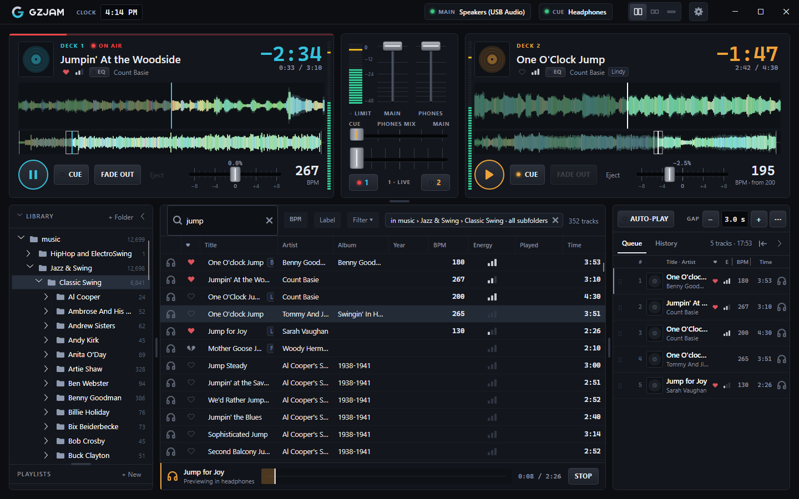
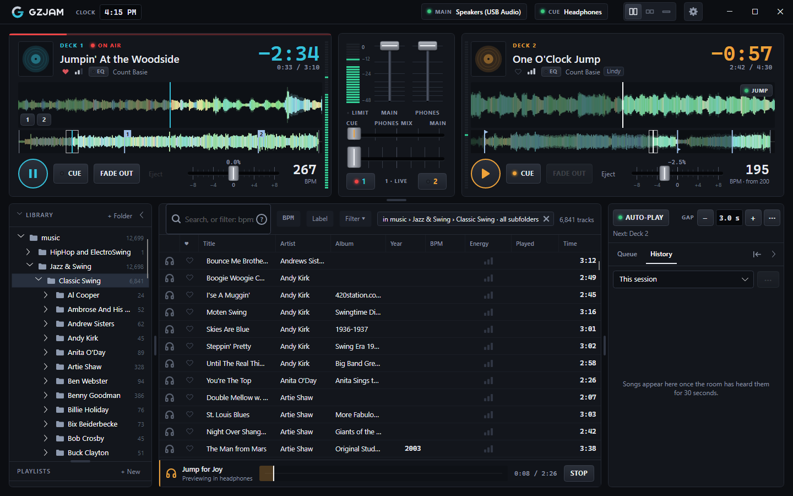
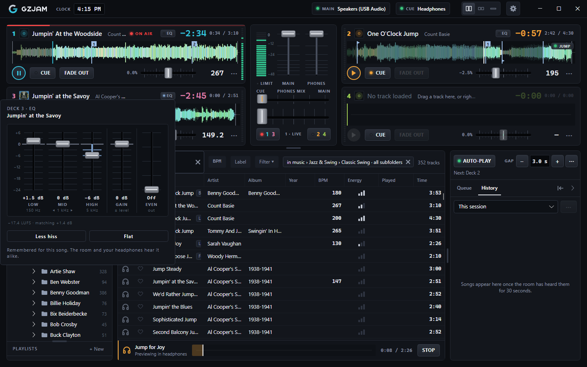
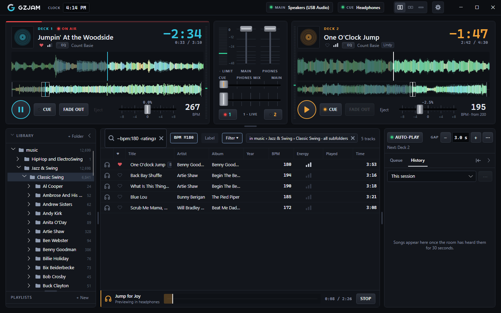

# GZJam user guide

GZJam is a free DJ app for social dance nights: swing, West Coast, blues, ballroom and more. You
play whole songs, choose them for the floor, and keep the music going without surprises. This
guide covers everything GZJam does, from your first song to what to do if the sound stops.



**Contents**

1. [Getting started](#getting-started)
2. [The screen](#the-screen)
3. [Outputs: speakers, headphones and booth](#outputs-speakers-headphones-and-booth)
4. [Decks](#decks)
5. [The mixer](#the-mixer)
6. [The library](#the-library)
7. [Your own music server](#your-own-music-server)
8. [The queue and auto-play](#the-queue-and-auto-play)
9. [History and set lists](#history-and-set-lists)
10. [Settings](#settings)
11. [At a gig](#at-a-gig)
12. [Problems](#problems)
13. [Keys and gestures](#keys-and-gestures)

---

## Getting started

1. **Install GZJam.** [Download the latest release](https://github.com/GemZombie/GZJam/releases/latest)
   and pick the file for your computer (see the [README](../README.md#download)). The first time
   you open it, Windows or macOS may ask you to confirm, since GZJam isn't signed with a paid
   certificate.
2. **Add your music.** Click **+ Folder** above the folder tree and pick your music folder. GZJam
   lists its songs in a few seconds (13,000 songs take about 3), then keeps watching it: songs you
   add, rename or delete later show up by themselves. You can add more than one folder.
   **GZJam never changes your music files unless you ask it to,** by moving songs in Organize music,
   or by dragging one from the queue to a folder and saying yes. Hearts, labels, cues and everything
   else you give your songs live in GZJam's own library.
3. **Choose your outputs.** Click **MAIN** in the top bar (or the gear, then *Sound*). Pick the
   **Speakers** (what the room hears) and the **Headphones** (only you hear them). Choose them by
   name rather than *Default*. Only one output? See [one output for both](#one-output-for-both-a-splitter-cable).
4. **Load a song.** Drag it from the list onto Deck 1, or right-click it › *Load to Deck 1*.
5. **Play it to the room.** The crossfader decides which side the room hears. Tap **1** under the
   crossfader, then press play on Deck 1: the deck says **ON AIR**.
6. **Cue the next song.** Load a song onto Deck 2 and press its **CUE** key: you hear it in the
   headphones while the room hears Deck 1. Or tap the 🎧 icon on any row in the list to preview it
   without loading it at all.
7. **Change over.** When Deck 1's song ends, press play on Deck 2 and tap **2** under the
   crossfader (it glides over in a moment). Or let [auto-play](#the-queue-and-auto-play) do it.

While GZJam works through your library the first time, the top bar says *First-time analysis…*:
it's listening to each song once, start to finish, to find where it really starts and ends, its BPM,
its loudness and its waveform. On a big library this takes a while (an hour or two for 12,000 songs,
depending on the laptop); once enough songs are done, the top bar says roughly how long is left, and
pointing at it says how many are done. It's done once: after that, only songs new to your music
folders are analyzed. You can play right away; a song you load or queue is analyzed first.

Now and then a new version of GZJam analyzes songs better, and listens to each one again, once: the
top bar then says *Updating analysis…*.

---

## The screen

- **Top bar:** the clock, what's happening in the background (scanning, analyzing), short notices,
  and your outputs: **MAIN** (the speakers), **CUE** (the headphones) and **BOOTH** once you've
  chosen one. A green light means it's playing; red or amber means it isn't connected. Click any of
  them to open Settings › Sound. The gear opens Settings.
- **Decks** along the top, with the **mixer** between them.
- **The library** below: the folder tree and playlists on the left, the song list in the middle.
- **The queue and History** on the right, with **AUTO-PLAY** and the **GAP** above them.

The dividers between the panels can be dragged to give one more room. To give the song list the
whole width, fold the library or the queue away with the arrow at the right of its header (or drag
its divider almost to the edge): it becomes a slim strip with its name, and a tap anywhere on the
strip opens it again. GZJam remembers the panels' widths, and which are folded.

**A long queue:** press **Ctrl+L** (Cmd+L on a Mac), or the arrow beside the queue's fold arrow, to
give the queue the room in the middle, with the song list narrowed beside it: handy on a night
spent reordering a queue of a hundred songs. The same key gives the song list the room back. Each
way keeps its own divider, where you last dragged it.

**Full screen:** **F11** (on a Mac, also **Ctrl+Cmd+F** or the green window button), and F11 again
to go back. In full screen, a key at the right end of the top bar leaves it too, for a touch screen
with no keyboard. Escape doesn't leave it, since Escape does other things in GZJam. Next time GZJam
opens, it's maximized rather than full screen. On tiling Linux desktops such as Hyprland, use the
desktop's own full-screen key.

---

## Outputs: speakers, headphones and booth

GZJam is the mixer: it sends the room's music to one output and your headphones to another.

- **Speakers:** what the room hears.
- **Headphones:** what you're cueing and previewing. **Never the room's output**: GZJam never sends
  the headphones to the speakers, even if something is unplugged.
- **Booth:** an optional monitor speaker at the DJ table, for big rooms where the speakers face
  away from you. It plays what the room hears (never your previews), at its own volume (*Booth
  volume*, under it in Settings).

A USB sound card for the speakers and the laptop's own jack for the headphones is the usual setup.

### One output for both (a splitter cable)

A laptop with one headphone jack and no sound card can still cue: turn on **One output for both
(splitter cable)** in Settings › Sound, and plug a DJ splitter cable into the jack (one stereo
plug to two mono sockets). The room plays from the left plug, your headphones from the right, both
in mono. Hearing it the wrong way round? Swap the two plugs. The top bar shows *Left ·* and
*Right ·* before the output's name.

### Speakers for GZJam alone (Windows)

Off by default. On, while GZJam is open, other programs' sounds (a notification, a browser) can't
reach the room. Other music programs can't use those speakers either: a player or an editor
refuses to play, or says the sound card can't be used, until GZJam closes. So turn it on for a
laptop kept for gigs, and leave it off on a computer where you edit or play music in other
programs too. It works for speakers chosen by name, not *Default*. If the speakers are also
Windows' default output, every other program may refuse to play while GZJam is open: Settings
says so, and how to avoid it (choose another output as Windows' default).

(Before 0.9.8 it was on by default. Settings saved by an older GZJam keep what they had.)

### When something is unplugged

- **The speakers' sound card:** GZJam says so and plays through the computer's default output
  instead, never the headphones' own. Plug it back in, then choose it again in Settings › Sound
  (*Plugged something in? Refresh the list*).
- **The headphones:** they go quiet, and nothing moves anywhere else. The top bar's CUE says
  *Unplugged* with an amber light. Plug them back in and within a few seconds they're back, with a
  notice, without a trip to Settings. The booth does the same.
- **Headphones on *Default*:** Settings warns you, because *Default* follows the computer's own
  choice, and when the headphones are unplugged the computer may move your preview to another
  output, even the room's. Choose the headphones by name.
- **A laptop whose headphone jack and built-in speakers are one output** (common with Realtek
  sound): the sound chip itself switches to the built-in speakers when you unplug, and GZJam can't
  tell. Test it before a night: preview a song and pull the plug.

---

## Decks

Two decks to start with; four if you turn on **Four decks** in Settings › Decks (Deck 3 under
Deck 1, Deck 4 under Deck 2, each half height).

**Deck size:** on a laptop, the decks can be made smaller so the library and queue show more songs.
The switch beside the gear in the top bar has three keys: **full** decks, **compact** decks, and
**hidden** decks; the lit one is the size now. Or press **Ctrl+D** (Cmd+D on a Mac) for compact and
back, or drag the small grip under the mixer: a little up for compact, further up for hidden, down
again for bigger (a tap on it switches compact). Settings › Decks › *Deck size* has the same three.
Switch as often as you like during a night: nothing playing is affected.

**Compact decks** keep the title, time, waveform, play, CUE, FADE OUT and tempo, with the rest in
each deck's ⋯ menu; the mixer keeps the meter, MAIN, PHONES and the crossfader (PHONES MIX is hidden
but still applies). With four decks, compact decks also leave out the waveforms. GZJam remembers the
choice.

**Hidden decks**, for the most songs on screen (the switch's third key, or **Ctrl+Shift+D**,
Cmd+Shift+D on a Mac), fold the decks and mixer away. They sit at the top of the queue instead, in
the order the room will hear them: first the deck the room hears, with its play key (two taps on
air, if you've chosen two taps), its song, the time left and the red bar filling as it plays; then
the other deck; then the queue. So the whole running order is in one column. Drop a song on a
deck's row to load it, protected as on the deck itself. With the queue folded away or History
showing, one line under the top bar stands in for the decks: the same play key, song and time
left, then what's next. Everything carries on as before: auto-play, the keys, the music. The
switch, the same key, the arrows at the end of the line, a tap on the grip or a drag down bring
the decks back.



### Loading and playing

- **Load:** drag a song onto a deck, or right-click it › *Load to Deck N*. Songs dragged in from
  Explorer, Finder or your Linux file manager load too, even from outside your music folders (a song
  a dancer brings on a USB stick).
- **Double-click a song** (in the song list, a playlist, the queue or History) and it goes on the
  deck that plays next, never the one on air:
  - Auto-play off: the deck the room isn't hearing, ready to cue and play; with nothing playing,
    the deck the room will hear when you press play.
  - Auto-play on: the deck waiting to play. The song that was ready there goes back to the top of
    the queue (see *Changing the very next song* under the queue). If that deck is busy (playing
    in the headphones, say), the song goes first in the queue instead.
- **The deck on air is protected:** by default GZJam won't load a song over the one the room hears.
  The deck shows a "not allowed" outline as you drag over it, and the menu says *(on air)*. Change it
  in Settings › Decks › *Loading a playing deck*. Once you've crossfaded over, the other deck (OFF
  AIR, still playing quietly) takes the next song straight away, with no need to pause it. In a
  blend, both decks are on air, so both are protected.
- **Play/pause:** the round key. **ON AIR** (red) means the room hears this deck; **OFF AIR** means
  it's playing but the crossfader is on the other side.
- **The red bar along the top** of the deck the room hears fills up as the song plays, so you can
  see at a glance how far in you are. It's full when the time left reaches 0:00 (where the music
  ends, not the file).
- **Eject** empties a deck that isn't playing.
- **One song per side:** with four decks, Decks 1 and 3 share the crossfader's left side and 2 and
  4 the right. GZJam won't start a deck the room would hear while the other deck on its side is on
  air ("Deck 1 is playing. Fade it out first").

### The readout

The big number is the time left, counting down to where the music ends (not the end of the file).
Tap it for time elapsed, then the BPM, then back. In the last 30 seconds of the song the room is
hearing it blinks slowly. When auto-play is about to start this deck, the status line says
*STARTS IN n*.

### The waveform

- **Two decks:** a close-up on top, the whole song underneath. The close-up scrolls past a fixed
  playhead; the box on the whole song shows what the close-up covers. Zoom with the mouse wheel or a
  pinch (2 to 30 seconds across).
- **Four decks:** the whole song; the mouse wheel or a pinch zooms that deck in.
- **Moving around:** off air, click or tap the whole song to go there, or drag the close-up like a
  record. Dragging along the whole song, the music plays on and the playhead follows you; it moves
  when you let go. **On air it's locked**, so a stray touch can't jump the music; tapping it says how to
  unlock it (move the crossfader off that deck). Cue keys and jumps still work on air.
- **The colors:** red is bass, green mids, blue highs. The shaded parts at either end are silence
  GZJam skips.

### Where a song starts and ends

GZJam finds where the music really starts and ends, so a 3-second gap is 3 seconds of real
silence every time. To set it yourself (after applause on a live recording, say), right-click (or
press and hold) the waveform › **Song starts** or **Song ends** › *Here*, *At the playhead* (find
the spot in the headphones first) or *Automatic*. A point you set gets a purple flag. You can also
drag the start and end markers.

**Fade out where you choose:** a song whose outro goes on too long, or repeats until it wears
thin, can fade rather than stop: **Song ends** › *Start fade-out here* (or *at the playhead*). From
there the song plays on, fading out over the fade-out length in Settings › Decks, and it's over
when the fade is: auto-play's gap comes after it. The waveform shows the fade as a slope after
the end flag, and the time left counts to the end of the fade. Dragging the end keeps its fade;
*Here*, *At the playhead* or *Automatic* make it stop there again.

### Cue keys

Mark up to four spots in a song to jump to at the moment you choose (wait for the end of a phrase,
then go to the outro): right-click the waveform › **Cue** › *Cue 1 here* or *at the playhead*. A
numbered key appears on the close-up; tap it to go there at once, on air or not. *Remove cue N* in
the same menu. With four decks, they're in the deck's ⋯ menu (*Go to cue N*). Cues can be dragged.

### Jumps

A jump leaves at the end of one phrase and lands at another, seamlessly: forward skips a part
(a long song's third chorus), backward plays one again (stretching a tune to fit a dance). Up to two
per song.

1. Right-click the waveform where it should leave › **Jump** › *Jump from here* (or *from the
   playhead*).
2. Right-click where it should land › *Land the jump here*.

The **JUMP** key over the waveform lights green when the song will jump. Each jump happens once;
tap JUMP to arm it again, or to cancel it for this play. The time left counts armed jumps.

### Tempo

The pitch fader changes the tempo up to ±8% without changing the key. Drag it (pressing beside the
cap never jumps the tempo), double-tap for 0, or use the mouse wheel or arrow keys for 0.1%. The BPM
under it is the song's BPM as the room hears it.

### BPM

GZJam detects every song's BPM (or uses the tag's). If it's wrong, right-click the BPM on a deck,
or songs in the list › **BPM**:

- **Detect in a range:** *Slow (60-110)*, *Medium (100-160)*, *Up-tempo (140-220)*, *Fast
  (200-320)*. GZJam listens again for the strongest tempo in that range, which fixes half- and
  double-time mistakes. Select a whole album to set them all at once.
- **Type the BPM…** if you know it.
- **Tap tempo…** (on a deck): tap along with the song on the TAP pad, then SET.
- **Automatic** goes back to what the tag or detection says.

### Hearts, energy and labels

The heart and energy bars beside the artist mark the song while it plays: tap to cycle. Labels
show as small chips. See [the library](#the-library) for what they're for.

### EQ, gain and evening out



The **EQ** chip opens a panel for fixing a recording, set once per song and remembered whenever it's
loaded: **low**, **mid** (◀ ▶ moves its frequency) and **high**, from -24 to +6 dB; **GAIN** on top of
loudness matching; and **EVEN**, which brings quiet passages up and loud ones down for an old,
uneven transfer. *Less hiss* turns the treble down 6 dB to start with; *Flat* resets it all. The chip
lights when a song has EQ. The room and the headphones hear it alike.

### Fade out

**FADE OUT** fades the deck out over 5 seconds (Settings › Decks › *Fade-out length*). It counts as
the song ending: auto-play waits the gap and starts the next one.

### Pausing or fading out a deck the room hears

So a stray touch or click can't stop the dance, the deck the room hears takes **two taps** to pause
or fade out: the first tap on the play key says *Tap again to pause*, and the first on FADE OUT
says *Tap again to fade out*; the key turns red for a few seconds, waiting for the second. Pressing
and holding the play key pauses too. A deck the room can't hear pauses and fades on one tap. To
pause and fade the live deck on one tap as well, choose **Tap** in Settings › Decks › *Pausing or
fading out the live deck*.

### From the taskbar or the Dock

With another program in front (an email, a playlist on the web), the song the room hears can
still be paused or faded without switching to GZJam:

- **Windows:** point at GZJam's button on the taskbar. Under its preview are three buttons:
  **play/pause**, **fade out** and **auto-play**.
- **Mac:** right-click (or Control-click) GZJam's icon in the Dock: the same three are in its menu.

They act on the deck the room hears (or, with nothing playing, the one ready on the crossfader's
side), as its own keys do: with two taps to pause on air, they take two clicks too, and the
button's tip (or the menu) says *Click again to pause*. With auto-play on, fade out is the next
song: the song fades, the gap, and the next one starts. There's no stop button: pause and fade
out are GZJam's stop. Linux desktops have no such place, so there's nothing there.

---

## The mixer

- **The meter** shows what the speakers play: one column in mono, two in stereo.
- **LIMIT** lights when the speakers are too loud and the limiter is holding them down. Turn a deck
  or the main volume down. Nothing GZJam plays can distort.
- **MAIN** and **PHONES** are the speakers' and headphones' volumes. From the keyboard: **Ctrl+↑/↓**
  (Cmd on Mac) turns MAIN up or down a little, and with **Shift**, PHONES.
- **PHONES MIX:** what the headphones hear. At **CUE** (the left), the decks you've cued and the
  preview; at **MAIN** (the right), what the room hears; in the middle, both.
- **The crossfader** fades the room between the decks: left is Deck 1 (and 3), right is Deck 2 (and
  4). Tap **1** or **2** to glide all the way over. It only decides what the room hears: the
  headphones are set per deck with **CUE**.
- **Each deck's own meter** (the slim column beside it) shows its level before the crossfader, so a
  deck the room can't hear shows its level too.

---

## The library

The song list shows your music; the folder tree shows it as it is on disk.

### Sources

The top of the library column lists where songs come from, each kept apart from the others:

- **My music:** your music folders, and every song you add to them from a server.
- **Servers** (once you've added one): each of your music servers, with its folders and playlists
  under it. Songs downloaded for the nights are the server's: they show under it, never in My
  music. See *Your own music server*.
- **Files:** the computer's own places (Desktop, Downloads, Music) and drives, and any USB stick
  as soon as it's plugged in, as plain folders. See *Files and USB sticks*.

Click a source to see all of it; the folder tree below shows its folders, and a search covers it
alone. The queue, History and playlists mix sources (a set is a set), so each of their songs has
its source's small icon by its title: a record for My music, a cloud for a server, a folder for the
computer's files, a stick for a USB stick. Point at it to see which. Under a search, a line says what the other source has, a click away: *Also: 4 on synology ·
Show* under a search of My music, *Also: 12 in My music · Show* under one of the servers.

### Files and USB sticks

For a one-off song (a request, a first dance, a dancer's edit on a stick) without leaving GZJam or
dragging it in. Click **Files**: *This computer* has your Desktop, Downloads and Music folders (and,
on Windows, your drives), and a USB stick shows under it as soon as it's plugged in, gone when it's
pulled out. Open a folder to see its songs (only music files show); the search box filters them by
name, as Files is never searched as a whole (a computer is too big to read at the moment you need a
song).

A song there plays as one of your own: preview it, load it, queue it, or give it a heart. Its BPM
and waveform come from analyzing it when it's loaded. **A song from a USB stick is read into GZJam
when it's loaded or queued** (or added to a playlist), so pulling the stick out never stops the
room; it's the song you see in Files from then on, with what you gave it.

**Add to my music** (right-click songs, or a folder or stick in the tree) copies them into your
music. Usually that's under *Added* and the folder they came from (*Music › Added › Gig Nov 14*), so
a stick's requests stay together, but you choose: see *Choosing the folder*, below. The originals
stay where they are; the copies are yours, with their hearts and cues, and show in My music. A stick is never added as a music folder: it comes and goes.
Songs that are in My music already (a folder of your music, seen in Files) say *Already in My
music* there instead.

### Organize music

For copying and moving songs around, without leaving GZJam: **Organize** at the top of the library
column, or right-click a folder › *Organize music…*. It takes the place of the library, song list
and queue, with the decks still above it and playing, and **Done** (or Esc) brings them back. Each
side opens where it was last time.

Each side shows My music or Files (the computer's places and drives, and USB sticks), as one list
with the folders on top. Double-click a folder to go in, and click the path above the list to go back
(or Backspace); *Find in this folder* narrows a long one. Select songs as you do in the song list,
and **drag them across**: they go to the folder the other side is in, or onto any folder you drop
them on. A plain drag moves, and holding Ctrl copies. Or use **Move** and **Copy** between the sides,
whose arrows show the way the songs will go and whose small print says what happens to them. Press
Space or the headphones to hear a song first, with the same player as under the song list. Songs
that just arrived are lit.

GZJam does what your file manager would, and the library shows where the files ended up:

- Into My music, the songs join it. Out of it, moved, they leave it. Between two folders outside My
  music, the library isn't affected.
- **A move never loses what you gave a song.** Hearts, cues, labels, BPM, EQ and plays go with it,
  its playlists and its place in the queue follow it, and **Undo** puts it back. Moved out of My
  music, they also stay at the old place, so a file put back in your file manager finds them.
- A copy has what the original has. A song never replaces another: it gets a number instead.
- A song on a deck can be copied, and moved once it's off the deck. The servers' downloads can be
  copied from, but they're GZJam's to look after, so they can't be moved or sent to.

Other apps that know your files (MediaMonkey, iTunes, foobar2000) lose track of files moved here,
as they do with any move, and GZJam says so the first time.

### From the queue to a folder

Drag songs from the queue onto a folder in the tree, or onto *My music* at the top of the library
column (handy when a server or Files is showing). Or right-click them › *Move to a folder in My
music…* (*Add to my music…* for a server's song or one from a USB stick). Nothing moves yet: a window
says what will happen and lets you change the folder, and one more press does it.

- A song in My music moves there, and one elsewhere on the computer moves there and joins My music.
- A song from a USB stick is copied, and the stick keeps its song. A server's song is copied too,
  downloaded first if it isn't here yet, and the server's song isn't touched.
- Its hearts, cues, labels and playlists go with it, and its place in the queue follows. A move has
  an **Undo**. A song on a deck stays where it is until it's off the deck.

### Choosing the folder

*Add to my music…* asks where the songs go, from a server, Files or a USB stick, showing My music's
folders. It opens on the last folder you chose, or on the usual place if you haven't chosen one, so
*Add* on its own puts them where they usually go (*Back to the usual place* returns to it). Pick a
folder and the songs go straight into it; tick *Keep their folders inside it* to bring the folders
they're in as well. *+ New folder* makes one inside the folder selected.

### Folders and search



- **Choosing a folder** narrows the list (and searches) to everything beneath it. Click it again to
  close it; the chip above the list shows the scope, and its ✕ goes back to all of the source.
- **Search** as you type, across titles, artists, albums, comments, Grouping, the other tags in
  your songs, folder names and file names (`balboa` finds songs in a *Balboa* folder). The best matches come first: songs whose
  title or artist has your words, then songs that have them somewhere else, and last, songs that
  only mention them in a comment. Put words in quotes to find them together: `"duke ellington"`.
  If a typo finds nothing, the empty list offers the search corrected (*Did you mean duke
  ellington?*), with how many songs it finds; tap it to search that.
  Ctrl+F (Cmd+F on a Mac) jumps to the search box; Escape clears it.
- **Filters** you can type:

  | Type | For |
  |---|---|
  | `bpm:140`, `bpm:130-150`, `bpm:>200` | a BPM, or a range |
  | `~bpm:140` | songs that can be pitched to 140 (within 8%; `~bpm:140/5` for 5%) |
  | `artist:basie`, `title:`, `album:`, `genre:`, `comment:`, `grouping:`, `folder:`, `file:` | one field (`artist:"count basie"` for words together; `file:` is the file name) |
  | `composer:ellington`, `dance:waltz` | any other tag in your songs, by its name: its letters and digits (`bandleader:` for a *Band leader* tag) |
  | `year:1938`, `year:1935-1940`, `year:<1950` | the year |
  | `rating:yes`, `rating:no`, `rating:none` | hearts |
  | `energy:high`, `energy:2-3` | energy |
  | `label:lindy`, `label:none` | labels |
  | `played:7`, `played:never`, `-played:7` | played in the last 7 days, never, or not this week |
  | `-live` | leave out a word or a filter |
  | `label:balboa OR label:charleston` | either one, words or filters (`OR` in capitals; `jump label:balboa OR label:charleston` is *jump*, and either label) |

- **Suggestions as you type:** start a filter's name (`ar`) and the box offers `artist:`; after
  one, it lists what's in your library: your labels after `label:`, the artists after `artist:`
  (with how many songs each), the genres after `genre:`, a tag's values after its name
  (`dance:`), the choices after `energy:`, `rating:` and `played:`. Tap one, or press ↓ and Enter. Escape closes the list; just keep typing to ignore it.
- **The BPM button** beside the search box fills in a BPM filter by tap: *Near Deck 1* (the deck's
  tempo as the room hears it), a tempo range, or *Any BPM*. **The Label button** does the same for
  labels, and **the Filter button** for energy, hearts, when the room heard a song, and the
  decade. Its *Search only in* puts the words you've typed into one field (`basie` becomes
  `artist:basie`), or back to everywhere. Each button writes its filter into the search box, so the
  box always shows the whole search, and lights up while one of its filters is there.
- **The ? in the empty search box** shows how to search, with the filters; tap one to try it.
- **Columns:** right-click a column header to show or hide ♥, Album, Genre, Grouping, Comment,
  Year, BPM, Energy, Played and Art, and, under *Tags in your songs*, any other tag your songs have
  (Composer, Mood, a Dance tag of your own: the ones most songs have first, the rest under *More
  tags*). Click a header to sort. Long text is cut off with "…"; point at it (or hold a finger on
  it) for the whole text.

### Marking songs

- **♥ (rating):** tap to cycle: a heart (I'd play this for a dance), a broken heart (I wouldn't),
  or nothing.
- **Energy:** low, medium or high (the three bars).
- **Labels** cut across your folders: "Lindy", "Balboa", "Female vocals", "Requests". Right-click
  songs › **Labels** › tick a label, or *New label…*. *Rename a label* is there too.
- **Played** shows when the room last heard a song ("3 days", "2 wk"). Songs played tonight have
  a green check before the title, everywhere. A grayed-out song with a ring and "!" is one whose
  file is missing (hover it to see where GZJam last saw it).

Select several songs to mark them all at once from the menu. None of this is written into your
music files.

### Previewing

Tap the 🎧 icon on any row (or press Space) to hear the song in the headphones without loading it.
The preview bar under the song list has its own position bar and STOP. Tap or drag along it:
the song plays on while your finger is down, and moves there when you let go.

### Playlists

Plan a set before the night. Under the folder tree, **+ New** makes a playlist; drag songs onto its
name, or right-click songs › **Add to playlist**. Songs and folders dragged from your file manager
go onto a playlist too, **even from outside your music folders**: they
join the playlist, not your library, so your collection stays as you've curated it. A song whose
file has been moved or deleted stays in the playlist, grayed out as missing, and is left out when
the playlist goes into the queue. Open it to see it in order: drag to reorder,
Delete to take a song out (the file isn't touched). **Add to queue** puts the whole playlist in the
queue; right-click a song › *Add to queue from here* puts the rest. For a random order, a
playlist's right-click menu (or the ⋯ beside *Add to queue*) has **Add to queue shuffled**. The queue's menu has *Save queue
as playlist…*, and History's ⋯ has *Save as playlist…*.

**Play** (beside *Add to queue*, or a playlist's right-click menu) plays the playlist, for a class
or a practice night: it takes the queue's place and auto-play turns on. A song playing finishes
first, then the playlist follows; the song that was ready next makes way for it. **Undo** in the top
bar puts back the queue and that song. **Play shuffled** (in the same menus) plays it in a random
order. Playing a playlist turns off *Repeat › This song*; *Repeat › The queue* stays on, so the
playlist goes round.

**More room for playlists:** drag the small grip on the PLAYLISTS header up for a longer list, or
down for more folders. If you only ever play from all of My music or a playlist, click the arrow
beside **LIBRARY** to fold the folders away: only your music folder shows, and the playlists take
the rest of the column. Opening a folder, or the arrow
again, brings the folders back. GZJam remembers both.

### Renamed and moved songs

Rename or move songs in your file manager whenever you like: a song keeps its hearts, labels, cues,
playlists and plays, even moved to another of your music folders, and a song in the queue or on a
deck follows it. Right-click a folder › *Read all tags again* if you've edited tags with a program
that keeps the file's date.

### Importing from Mixxx

Settings › Library › **Import from Mixxx** brings over ratings (4-5 stars as ♥, 1-2 as a broken
heart), crates as labels, playlists, History, locked BPMs and hot cues 1 to 4. It shows what would
come over first, only fills gaps (your GZJam marks stay), and never changes Mixxx.

### Importing from other players

- **Playlists:** Settings › Library › **Import playlists**. Save your playlists as `.m3u`
  or `.m3u8` files from MediaMonkey, foobar2000, iTunes / Music (*File › Library › Export
  Playlist*, as M3U or as text), VirtualDJ or most other players, then pick them (several at
  once is fine). Each becomes a playlist of the same name, in order. GZJam says first how many
  songs it found, and where the ones it didn't are (add that folder with **+ Folder**, then import
  again). A playlist GZJam already has by that name is left alone, so importing again adds
  nothing twice.
  **Playlists from another computer** work too, even old ones where the music was on another
  drive (`D:\Music\Swing` then, `C:\Music\Swing` now): GZJam finds each song by its file name
  and the folder it's in, and says where it found them before importing. There's nothing to edit
  in the playlist files.
- **Ratings saved in the song files:** Settings › Library › **Ratings in the song files**.
  MediaMonkey, foobar2000 (when it's set to write ratings to the files), Windows Media Player and
  others can keep a star rating inside each song file. GZJam reads them for your unrated songs
  and shows what it found: 4-5 stars become ♥, 1-2 stars a broken heart, 3 stay unrated. Songs
  you've rated in GZJam keep their rating. In a big library reading takes a few minutes. iTunes /
  Music keeps its ratings in its own library rather than the files, so there's nothing to read there.
  WMA files' ratings are read too.
- **Grouping and Comments,** as iTunes, Music and many other players keep them, are in the song
  files themselves, so GZJam reads them without any import: show the *Grouping* and *Comment*
  columns, and search them (`grouping:balboa`). Handy if you sort your music by dance, feel or era
  in those fields. (iTunes ratings and play counts aren't in the files.)
- **Any other tag** in your song files is read the same way: the composer, the conductor, a mood,
  the key, the dance or band leader in a tag of your own (foobar2000's and Mp3tag's custom fields,
  MediaMonkey's, iTunes'), whichever kind of file it's in. Show it as a column and search it
  (`dance:waltz`). Tags only other programs use (MusicBrainz IDs, ReplayGain, the encoder) and long
  ones like lyrics are left out.
- **Song info:** right-click a song › *Song info…* (in the song list, the queue or History), or
  select it and press **Ctrl+I** (Cmd+I on a Mac), for everything about it in one window: its tags,
  every other tag in the file, the file itself (where it is, MP3 or FLAC, the bitrate, the sample
  rate, the length, the size) and what GZJam knows about it (its BPM and where that came from,
  rating, energy, labels, how often and when it was played, cues, EQ, loudness, the playlists
  it's in). Tick *Show all tags* to see the ones only other programs use as well (MusicBrainz IDs,
  ReplayGain, sort names, the encoder); GZJam remembers. The window isn't in the way of the decks:
  click back to GZJam while it's open. Escape closes it. Any text in it can be selected and copied.
- **Edit tags** right there: type over the title, the artist, the genre, the BPM or any other tag,
  and press *Save* (or Enter). Empty a field to take that tag off. *Add a tag* gives the songs one
  they haven't got, like a Dance tag of your own. The rating, energy and labels change there too.
  *Cancel* puts the fields back; after saving, *Undo* puts the songs back as they were (the notice
  in GZJam's top bar has one too).
- **Several songs at once:** select them (a search, then Ctrl+A, finds every song by an artist
  spelled one way) and open their info. A field they all share shows its value; one where they
  differ says *(several)* and is left as each song has it, unless you type over it. To take such a
  tag off all of them, click its ✕. GZJam says how many songs before it changes them.
- **Tags from file names:** a song with no title or artist tag shows what its file name says,
  in italics (`1924 Ma Rainey - Lucky Rock Blues.mp3` reads as *Lucky Rock Blues* by *Ma Rainey*),
  in the song list, the queue, the decks, History and set lists. To make it stick, select the
  songs, open their info, and click **Fill tags from file name…**: GZJam guesses how the names
  are laid out (`{year} {artist} - {title}`, `{artist} - {track} - {title}`…), shows what each
  name gives, and fills the empty tags (untick *Only tags that are empty* to fill over the others
  too), each song its own. Change the pattern if the guess is wrong: `{artist}`, `{title}`,
  `{year}`, `{track}` and `{album}` where they are, `{skip}` for a part to leave out. Undo puts
  them back.
- **Kept in GZJam, or written into the files:** at first, your edits are kept in GZJam's library
  only. GZJam shows and searches them, a backup keeps them, and they last even if the file's tags
  change later. A dot beside a tag's name marks one of these edits; *Use the files' tags* forgets
  them. Turn on **Write tag edits into the song files** (Settings › Library, or the box in the
  window) to write them into the files as well, so MediaMonkey, foobar2000, iTunes and other
  players see them. Only the tags are written, never the audio. A song on a deck, or a file that
  can't be written (read-only, or on a drive that can't be written to), keeps the edit in GZJam's
  library instead, and the window says so.

Unless you turn on writing tag edits, the files are only read, never changed.

---

## Your own music server

Keep your music on a NAS or home server and play it anywhere: GZJam signs in to
[Navidrome](https://www.navidrome.org/), or another server that speaks the Subsonic API, and shows
its songs in the library beside your own. One rule makes it safe for a night: **the room only ever
plays songs on this computer.** Songs come down before the night, or the moment you ask for one;
streaming is for the headphones only, so a Wi-Fi drop never stops the music.

### Adding a server

Settings › Servers › **ADD A SERVER…**: a name for it (*synology*), its address (`synology:4533`,
or the address Tailscale gives it), your user name and password. GZJam signs in before saving and
says what it found: the server, how many songs it has, and whether your account may download them.
An account that can't download is **preview only**: its songs can be heard in the headphones, never
played to the room, and GZJam says so now rather than at the moment you try. The password is kept in
the computer's keychain (Windows Credential Manager, the Mac's Keychain, the Linux desktop's), never
in GZJam's settings or a backup. Add as many servers as you like, your own and a friend's.

### Browsing

Click **Servers** in the library's sources: each server is in the folder tree, with its folders under it as they are
on the server (or by artist and album, for a server that doesn't say), and its playlists under
*Playlists*. GZJam reads its song list when it's added and at most twice a day, only when the
server has read its music since (Navidrome says when; right-click it › *Read its song list again*
after adding music there), so it's searched as fast as your own folders,
offline too, with the same filters. **Songs not on this computer are dimmed, with a cloud** by the
title. Preview one in the headphones as usual. A double-click, a load onto a deck, or *Add to queue*
downloads it first: a deck takes it only once it's here, and never the deck the room hears, and in
the queue it waits in its place, *Downloading…*, then becomes the song. With nothing chosen, a
search covers every server. Under a search of My music, *Also: 12 on synology · Show* searches the
server too. A song that's in My music as well (added to it, or yours already) says **in My music**:
it plays your own copy, so there's no need to add it.

### Sending a playlist to your server

For posting a setlist the next day: History's ⋯ › *Save as playlist…*, then right-click the playlist
› **Send to synology** (with several servers, *Send to* lists them). It's made on the server in its
order, under its name, with the songs the server has; any it doesn't have are named first and left
out. Sending it again updates the same playlist. A playlist kept from the server doesn't offer this,
as a sync already makes it the server's again.

**Share a link…** sends the playlist if it isn't there yet, makes a link anyone can open and listen
to, and copies it, ready to paste into your post. Navidrome only makes links with sharing turned on
(`ND_ENABLESHARING=true`, *EnableSharing* in its settings).

### Songs on this computer before the night

- **Keep on this computer:** right-click the server › *Keep on this computer…* and choose its
  playlists and what's starred there (songs, albums and artists you starred in Navidrome). Then
  *Sync now*. Each playlist becomes one of your playlists and follows the server's on every sync;
  a cloud marks it (right-click › *Stop following the server* makes it yours).
- **A song, an album, a folder:** right-click songs › *Download to this computer* or *Download the
  album*, or a server's folder › *Download to this computer* (kept up to date as songs are added).
- **Where they go:** *GZJam from servers* in your Music folder (Settings › Servers › CHANGE… moves
  them, with their hearts, cues and EQ), laid out as the server has them. It's where GZJam keeps
  the server's songs for playing offline, not one of your music folders: its songs show under the
  server, not in My music. A song you already have (the same title, artist, and size or length)
  isn't downloaded again.
- **Sync when GZJam starts** (Settings › Servers) brings what you chose up to date in the
  background, pausing once the room hears music.

### Adding songs to My music

Downloaded songs are copies for the nights, in GZJam's downloads folder, removed only as you say
(see *Room on a small drive*). **Add to my music** (right-click songs, a server's folder or playlist) copies them
into a music folder of your own, which you choose once (Settings › Library › *Songs you add go to*), laid out as on the server: your own songs from
then on, in My music, never removed by GZJam, played with or without the server, and tags can be written into
them. A downloaded song moves there with its hearts, cues, labels, playlists and plays; nothing in
the folder is ever replaced, and GZJam shows where they'll go before anything happens.
Right-click the server › **Add the whole server to my music…** brings all of it, a song at a
time in the background: it pauses while a song plays to the speakers (unless Settings › Servers
lets it go on), can be held to a speed, paused and resumed, picks up where it left off after a restart, and songs
added to the server later come too. Good for bringing a library home a bit at a time.

### What's coming down

The top bar shows what's downloading; click it, or right-click a server › **Downloads…**, for every
song coming down: what it's for (a sync and its playlist, the queue, a deck, adding to My music), how far along
("4.2 of 9.8 MB"), and why one failed. *Stop* on a song stops just that one; **Stop all** (or *Stop*
in the top bar) stops syncs and keeps after the song coming down, pauses a whole server, and stops
the queue's downloads, though a song a deck waits for still comes. *Retry failed* tries again.
A playlist kept by mistake? Right-click it under the server › *Stop keeping on this computer…*.

### Hearts

A ♥ on a server's song stars it on the server too, so Navidrome's own app and web page show the same
favorites; taking it off takes the star off. Stars are saved under your account, so a friend's own
aren't changed, and a server that can't be reached is told once it answers. Untick *Send my hearts*
on a server's card in Settings › Servers to leave one out. Tag edits stay in GZJam: no server takes
them.

### Room on a small drive

- **Remove from this computer:** right-click downloaded songs, or a server's folder; or right-click
  the server › *Free up space…*: what was downloaded for the last night, what hasn't been played in
  4 weeks, or everything, with what each frees. They stay on the server, and a sync doesn't bring
  them back until you ask for one.
- **Keep downloaded songs** (Settings › Servers): *Until I remove them* (the default), *For 4
  weeks after they were last played*, or *For the night only* (songs downloaded for the queue or a
  deck go the next time GZJam starts).
- **Room for downloaded songs:** a limit. A sync that would pass it makes room with the downloads
  played least recently.

Neither ever removes a kept list's songs, songs you downloaded on purpose, your own songs, or
anything on a deck, in the queue or played tonight. Songs moved or renamed on the server move here
too, rather than downloading again.

### When the server can't be reached

No Wi-Fi, venue Wi-Fi without your Tailscale, the NAS asleep: the server gets a crossed-out cloud
in the folder tree, its songs still show (GZJam keeps its song list), and *Only on this computer*
turns on by itself to show what can be played tonight. Everything already here plays as usual.
GZJam asks again every couple of minutes and when the network changes; queued songs waiting for it
come once it answers.

### Setting up Navidrome on a Synology

1. In **Container Manager**, make a project (say *navidrome*) in a folder like
   `/volume1/docker/navidrome`, with this, changing the music folder to yours:

   ```yaml
   services:
     navidrome:
       image: navidrome/navidrome:latest
       user: 1026:100   # your Synology account: it must own the data folder and read the music
       ports:
         - "4533:4533"
       restart: unless-stopped
       environment:
         ND_SUBSONIC_DEFAULTREPORTREALPATH: "true"   # so GZJam lays songs out as your folders are
       volumes:
         - /volume1/docker/navidrome/data:/data
         - /volume1/Music:/music:ro
   ```

   Your account's numbers come from `id` in an SSH session (often `1026:100` for the first account).
   Without the real paths setting, Navidrome hides its folders, and GZJam lays songs out by artist
   and album instead.
2. Open `http://<your NAS>:4533` in a browser and make the first account: it's the admin. Navidrome
   reads your music; downloads are allowed unless `ND_ENABLEDOWNLOADS` is set to `false`.
3. In GZJam, Settings › Servers › ADD A SERVER… with that address and account.

Other ways to run Navidrome (a Raspberry Pi, Docker anywhere, Windows, a Mac) are in
[its own guide](https://www.navidrome.org/docs/installation/).

### From anywhere: Tailscale

[Tailscale](https://tailscale.com/) puts the NAS and your laptop on a private network of their own,
wherever they are, with nothing opened on the router. Install it on the Synology (Package Center)
and on the laptop, signed in to the same account, and use the NAS's Tailscale name as the server's
address: `http://synology:4533`. At a venue, the laptop reaches home over whatever Wi-Fi there is;
without one, the songs already on the laptop are what you play.

### A friend's server

Two things from your friend: **an account of your own** on their Navidrome (they make it in its web
page; it's theirs to remove whenever they like, and you never use their login), and, if it's away
from your network, **their machine shared with you** in Tailscale (*Share* on the machine, to your
email). Downloads must be allowed for the songs to play to the room; otherwise the server is preview
only. Your hearts are saved under your account there. Whether to keep copies of a friend's music is
between the two of you.

---

## The queue and auto-play

The queue is tonight's list of songs to come.

- **Adding:** drag songs into it (a line shows where), right-click › *Add to queue* or *Play next*,
  or press Enter (Shift+Enter: play next). Files and whole folders dragged from your file manager go
  in too. A song that's in the queue already still goes in, but the top bar says so (*"Shiny
  Stockings" is in the queue already (5th)*), with **Undo** to take the new copy out again. The same
  goes for a playlist.
- **Reordering:** drag a row by its ⋮⋮ grip. Right-click › *Move to top*, *Remove*, *Clear queue*.
  *Shuffle queue* puts it in a random order, with **Undo** in the top bar to put it back.
- **Keys:** ↑ ↓ move through it; **Space** previews the selected song in the headphones (again:
  stops); **Delete** takes it out and selects the next, so you can keep going.
- **Loading from it:** drag a queued song onto a deck, or double-click it; it leaves the queue
  (with *Repeat: The queue*, it goes to the end).
- **Changing the very next song:** with auto-play on, the deck waiting to play is the front of the
  queue. Load another song onto it and the song that was there goes back to the top of the queue,
  so it plays right after your new pick (the top bar says so, with **Undo** to take it out).
- **What it shows:** right-click › *Show* ticks what the queue shows of each song, besides the title
  and artist: album art, ♥, energy, labels, album, genre, year, when it was last played, BPM and
  time. Album, genre, year and played start off; they fit best in a queue given the room with
  **Ctrl+L**. GZJam remembers your choice.

### Auto-play

Turn **AUTO-PLAY** on and GZJam runs the night: when the song the room hears ends (or is faded
out), it waits the **GAP**, starts the next song on the other deck and glides the crossfader over,
then loads the one after. The next song is always waiting on a deck, so you can see what's coming,
and cue it in the headphones.

- **The gap** (− and + beside it, 0 to 15 seconds) is real silence between songs, whatever silence
  each file starts or ends with.
- **When the queue ends:** beside the clock at the top, **ENDS** says when the music queued runs
  out, as a time of day, once a song plays to the room (before then it shows a dash). It counts
  what's left of the song playing, the songs ready on the decks and in the queue (each from where
  it starts to where it ends, with its fade and jumps) and, with auto-play on, the gaps. When *Stop
  at* or *Stop after this song* comes first, it's when auto-play stops instead (point at it: the
  tip says which). With *Repeat*, the queue doesn't run out: a dash. With auto-play off, it's the
  time if you played everything one after another.
- **Options** (the **⋯** key beside the gap), for classes, practice nights and the end of the
  night. Whatever is set shows under AUTO-PLAY, e.g. *Fade after 1:30 · Stops at 11:00 PM*.
  - **Fade after** (*Off*, or 1:00 to 5:00 in 15-second steps): each song the room hears fades out
    after that long, from where its music starts, over the *Fade-out length* in Settings › Decks.
    Then the gap, and the next song. A song shorter than that plays to its end. The deck's time
    counts down to the end of the fade, and under it says where the fade comes (*0:42 / fade
    1:30*). Move a song on past that point and it plays on; turn auto-play off and every song
    plays to its end again. Remembered.
  - **Wait for me after each song:** when a song ends, the next is lined up and the crossfader
    moves to it, but it waits: *Deck 2 is ready: press play*. Press play on it when you (or the
    teacher) are ready, and auto-play carries on from there. Turn it off while a song is waiting
    and that song starts.
  - **Repeat** (*Off*, *The queue* or *This song*):
    - *The queue:* each song goes back to the end of the queue as it's loaded onto a deck, so the
      queue goes round and a playlist plays over and over: for a class, a practice night or music
      between sets. With **Add to queue shuffled**, it's a shuffled playlist on repeat.
    - *This song:* the song playing plays again and again, with the gap between: it goes on the
      other deck instead of the next song in the queue. The song that was waiting there goes back
      to the top of the queue, and the queue waits. Choose *Off* or *The queue* and the next song
      in the queue is lined up again.
    - *Stop at* still ends the night.
  - **Stop at** (*Off*, or a time, every quarter hour for the next 8 hours): the song playing then
    is the last; auto-play turns itself off when it ends, and says so.
  - **Stop after this song:** just this once, for an announcement (a birthday jam, a class
    starting, the band setting up). The deck playing says *ON AIR · LAST SONG*. When the song
    ends, the room goes quiet: the next song is lined up on the other deck and waits, as with
    *Wait for me*. Press play when you're ready, and auto-play carries on as before. It turns
    itself off once it's done (or with auto-play).
  - *Wait for me*, *Repeat*, *Stop at* and *Stop after this song* are for tonight: they're off
    again the next time you open GZJam, so a dance next week isn't left waiting, looping or cut
    short.
- **Turning auto-play off** never touches the song that's playing: it only stops the next one
  starting. It turns itself off, with a notice, when the queue runs out (never, with *Repeat*).
- During the gap, grabbing the crossfader stops its glide; the next song still starts.

---

## History and set lists

The **History** tab beside the Queue is the record of every night.

- A song counts as played once the room has heard it for 30 seconds (or a shorter song to its end).
  Previews, cueing and songs faded out early don't count.
- **A session is a night:** restarting GZJam within three hours carries on the same one.
- Pick a night from the drop-down. Its ⋯ menu: *Name this session…* ("Friday Night, Oct 14"),
  *Export set list…* (as text, or a spreadsheet), *Save as playlist…*, *Delete this session…*.
- Songs in History can be previewed, dragged onto a deck or into the queue, or shown in the folder
  tree.

---

## Settings

The gear in the top bar. Music keeps playing while it's open; DONE, Escape or a tap outside closes it.
**QUIT GZJAM**, at the bottom of the side column, closes GZJam itself: for Linux desktops that draw
no title bar (and so no close button), or a touch screen. It asks first while the room hears music.

- **Sound:** Speakers, Headphones, *One output for both*, Booth and *Booth volume*, *Speakers for
  GZJam alone* (Windows), **Mono** (on: the room and headphones play mono, so the whole floor hears
  instruments recorded on one side), **Match loudness** (on: songs are turned toward the same
  loudness, so a quiet 1938 transfer and a loud remaster play at about the same level), **Loudness
  target** (what matching aims at: -16 LUFS usually; -18, -20 or -23 leave more headroom for a
  mixer or PA that clips easily, so turn its channel up to make up for it), and **Extra protection
  against crackles**.
- **Decks:** *Four decks*, *Compact decks*, *Fade-out length*, *Loading a playing deck* (Block it, Ask first, Allow
  it), *Pausing or fading out the live deck* (Tap, or Tap twice).
- **Screen:** **Touch mode**: bigger keys, rows, menus and crossfader for fingers. Touch works
  either way.
- **Library:** *Songs you add go to* (where *Add to my music* copies songs, from a server or Files), *Import from Mixxx*, *Import playlists*, *Ratings in the song files*, **Back up my library**, **Restore a backup**, *Start over with
  an empty library*, and *Near a BPM* (how far `~bpm:` reaches).
- **Servers:** your music servers (ADD A SERVER…, TEST, EDIT…, REMOVE…, *Send my hearts*), and
  for the songs downloaded from them: where they go, adding a whole server to My music (its
  speed, and whether it goes on while music plays, shown once a server is being added whole), *Keep downloaded songs*,
  *Room for downloaded songs*, and *Sync when GZJam starts*. See
  [Your own music server](#your-own-music-server).
- **About:** the version, *Tell me when a new version is out* (at startup GZJam asks GitHub, and
  says so quietly in the top bar before the music starts; nothing about you or your music is sent),
  *Check now*, and the software GZJam is built with.

### Backing up your library

Your hearts, labels, cues, playlists and History are in GZJam's library, not your music files.
**Back up my library** saves them, with your Settings, in one `.gzjam` file: keep it on a USB stick
or in a cloud folder. **Restore a backup** puts one back: it says what's in it and asks first, then
GZJam opens again with it. The library it replaces is kept in the *previous libraries* folder, never
deleted. GZJam also keeps a copy of its own each day it's opened, the last five, in its data folder
under `backups`.

---

## At a gig

### Plugging into the venue's sound

**Which input.** Use a **line input** on the venue's mixer: a stereo channel's pair of jacks or
RCA sockets, or a mono channel's line jack. A microphone input (the XLR socket on a mic channel)
expects a far quieter signal: a laptop overloads it unless its gain is all the way down, and it
hisses. If a mic input is all there is, put a **DI box** in between.

**Which cable.** From a laptop's headphone jack or a small sound card: a 3.5 mm stereo plug to two
6.35 mm (1/4") plugs or two RCA plugs, whichever the mixer has. From a sound card with its own
outputs, cables to match them. Keep it short: across a hall, use a DI box at the DJ table and a
microphone cable to the mixer, which doesn't pick up hum on the way.

**Nothing else in the room (Windows).** On a laptop kept for gigs, turn on *Speakers for GZJam
alone* (Settings › Sound), so no notification or browser sound reaches the room mid-set.

**Mono.** At most dances the speakers stand on both sides of the floor, and dancers near one hear
mostly that side. In stereo, they'd lose whatever was recorded on the other (on many old
recordings, half the band). With **Mono** on (Settings › Sound, on by default), both sides play
the whole song. It also means that if the mixer has only a mono channel free, one cable from
either side carries everything.

**Setting the levels.** Do this before the doors open, once:

1. On the mixer: the channel's fader and the master fader down, the channel's **gain** (or
   **trim**) at its lowest, its EQ in the middle.
2. In GZJam: **MAIN** near the top. Play the loudest song you'll play. With *Match loudness* on,
   most songs play at about the same level, so any typical song will do.
3. Turn the channel's gain up until its meter peaks just under 0 (or the peak light only just
   flickers on the loudest moments). Lower is safer than higher.
4. Bring the channel's fader up to its mark (0, or U), and set the room's level with the master
   fader.
5. From then on, the room's level is the mixer's. Leave **MAIN** where it is. GZJam's **LIMIT**
   light stays off.

Why this way round: GZJam sends its cleanest signal with MAIN near the top. MAIN low with the
mixer's gain high adds hiss; MAIN high with the mixer's gain high distorts in the mixer, where
GZJam's limiter can't help.

**The mixer's channel distorts even with its gain at the lowest** (a mic input, an older mixer,
or a channel set up for something quieter): choose a lower **Loudness target** in Settings › Sound
(-20 or -23 LUFS), so everything leaves GZJam a few dB quieter, or turn MAIN down.

**No mixer: straight into a powered speaker or PA.** Then MAIN is the room's volume. Start with
MAIN low and the speaker's own volume at about its middle, play a song, and set the speaker so that
MAIN at about three quarters is as loud as the room will need. That leaves room to turn up as the
floor fills, without the speaker distorting.

**Hum or buzz.** A laptop on its charger, plugged into a different outlet from the sound system,
often hums through the speakers (a ground loop). Try these in order:

- Plug the charger into the same power strip as the mixer.
- Unplug the charger for a moment: if the hum stops, it's a ground loop. (Don't play the night on
  battery.)
- A DI box with a ground lift switch, or a ground loop isolator (a small box that goes in the audio
  cable).
- A USB sound card instead of the laptop's own jack. Some laptops' jacks pick up the computer's
  own noise: a whine that changes when you scroll or the screen changes.

Never remove the ground pin from a power plug.

**Before the doors open**

- [ ] Plug in the sound card, then open GZJam. MAIN and CUE in the top bar are green and name the
      right outputs.
- [ ] **Mono** on (Settings › Sound), unless you know you want stereo.
- [ ] Play a song to the room and preview another in the headphones: the preview is in the
      headphones only.
- [ ] Set the levels: **MAIN** near the top, then the mixer (see
      [Plugging into the venue's sound](#plugging-into-the-venues-sound)); the **LIMIT** light
      stays off.
- [ ] Plug the laptop into power, and set it to its best performance mode. Turn off sleep, and
      updates that might restart it.
- [ ] Optional: queue the start of the night, and turn on auto-play.

**During the night**

- Watch for **LIMIT**: if it's lit often, turn down.
- A notice at the top says what GZJam just did (an output reopened, a load refused, a song that
  couldn't be found).
- Closing GZJam while the room hears music asks first; *Keep playing* is the default.
- Open GZJam again and the queue and decks are as you left them, each deck paused at the start of
  its song.

**If the sound stops**

1. Look at **MAIN** in the top bar. Red: the speakers' output is gone. Check the cable and the
   sound card; GZJam has moved the music to the computer's default output, and says so.
2. Look at the deck: is it **ON AIR**? Is the crossfader on its side? Is **MAIN** turned up?
3. If GZJam closed by itself or the laptop restarted, open it again: **the night comes back**. The queue and
   the decks are as they were, each song paused where it was. Press play.

---

## Problems

**The sound crackles or drops out**

- Turn on **Settings › Sound › Extra protection against crackles**. Play and the crossfader respond
  a little later, which hardly matters for social dancing.
- Use a wired output: Bluetooth speakers and headphones add delay and drop out.
- Plug the sound card straight into the computer rather than through a hub or dock.
- Keep the computer plugged in, at its best performance mode.

**The venue's sound distorts, hisses or hums:** see
[Plugging into the venue's sound](#plugging-into-the-venues-sound).

**The speakers won't open**

- Another program may have the sound card to itself: close it, then choose the speakers again in
  Settings › Sound.
- On Linux, the desktop's sound system keeps a card while other sound plays through it. Make
  another output the computer's default, or choose *Default* in GZJam.

**Other programs can't play while GZJam is open (Windows)**

*Speakers for GZJam alone* is on (Settings › Sound), so the speakers are GZJam's only. A music
player or editor using the same speakers refuses to play, or says the sound card can't be used.
Turn it off to share them. If every program has gone quiet, those speakers are also Windows'
default output: choose another output as the default in Windows' Sound settings, or turn the
switch off.

**A song's BPM is wrong:** right-click it › **BPM** › *Detect in a range*, or *Type the BPM…*.

**A song starts late or ends early:** set its start and end yourself (right-click the waveform ›
*Song starts* / *Song ends*).

**A song won't play:** it may have been moved or deleted, be AAC on Linux or WMA on a Mac or Linux,
which GZJam can't play there, or be a copy-protected WMA bought years ago, which only the player it
was bought for can play; the notice says which. GZJam plays MP3, FLAC, WAV, AIFF, OGG Vorbis, Opus
and Apple Lossless everywhere, AAC on Windows and Mac, and WMA on Windows.

**"The library is from a newer GZJam":** a newer version (or a test build) upgraded your library.
Install the newest GZJam.

**Reporting a problem:** [open an issue](https://github.com/GemZombie/GZJam/issues/new/choose) and
attach the activity log. It's in GZJam's data folder under `logs/`:

| | |
|---|---|
| Windows | `%LOCALAPPDATA%\GZJam\logs` |
| Mac | `~/Library/Application Support/GZJam/logs` |
| Linux | `~/.local/share/GZJam/logs` |

---

## Keys and gestures

The keys that start with Ctrl (Cmd on a Mac) work from anywhere, most of them from the search box too. FADE OUT has
no key on purpose: one keypress ending the song the room hears is too easy to hit by mistake.

| | |
|---|---|
| **Enter** | add the selected songs to the queue (**Shift+Enter**: play next) |
| **Space** | preview the selected song in the headphones (in the library or the queue) |
| **Delete** | take the selected songs out of the open playlist, or out of the queue |
| **Ctrl+1 / Ctrl+2** (Cmd on Mac; 3 and 4 with four decks) | play or pause that deck (two presses on air, if you've chosen two taps) |
| **Ctrl+Shift+1 / 2** | that deck's CUE (headphones) on or off |
| **Ctrl+Alt+1 / 2** (Cmd+Option on Mac) | load the selected song onto that deck: from the queue if you're in it (it leaves the queue), otherwise from the library |
| **Ctrl+← / Ctrl+→** | the crossfader glides to Deck 1 / Deck 2 (in the search box they move by word, as usual) |
| **Ctrl+P** | auto-play on or off |
| **Ctrl+↑ / Ctrl+↓** | MAIN volume up or down, a little each press |
| **Ctrl+Shift+↑ / ↓** | PHONES volume up or down |
| **Ctrl+F** (Cmd+F) | search |
| **Ctrl+I** (Cmd+I) | the selected songs' info, to see or edit: in the song list, the queue or History |
| **Ctrl+D** (Cmd+D) | compact decks, and back |
| **Ctrl+Shift+D** (Cmd+Shift+D) | hide the decks (one line at the top instead), and back |
| **Ctrl+L** (Cmd+L) | give the queue the room in the middle, and back to the song list |
| **F11** (on a Mac, also **Ctrl+Cmd+F**) | full screen, and back |
| **Ctrl+,** or **Ctrl+O** (Cmd+, or Cmd+O) | Settings, and closed again |
| **Escape** | clear the search; close Settings; cancel a drag |
| **↓** in the search box | into the results |
| **Right-click**, or **press and hold** | a song's, a deck's or a waveform's menu |
| **Mouse wheel** or **pinch** on a waveform | zoom |
| **Double-tap** the tempo or an EQ fader | back to 0 |

**By touch:** everything works by finger. In the song list, swipe sideways (toward the queue and
decks) to drag a song, up and down to scroll; press and hold to pick one up and drag it anywhere,
or lift without moving for its menu. In the queue, drag by the ⋮⋮ grip. Faders move by as much as
your finger does, so a slightly missed cap never jumps.
